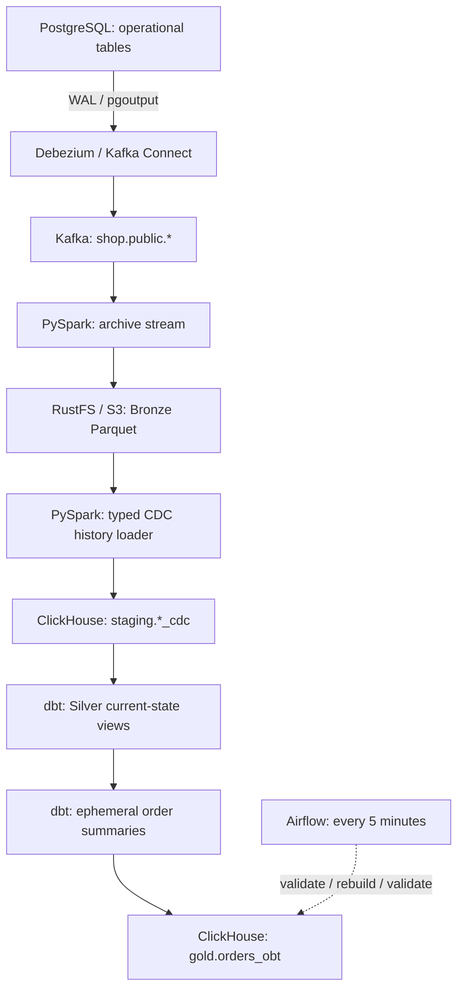

# DE Orders Platform

[English](#english) | [Русский](#русский)

## English

A Data Engineering portfolio project that captures changes from an online store database, archives them in S3-compatible storage, and builds an enriched orders table in ClickHouse.

The implemented pipeline combines PostgreSQL CDC, Kafka, two PySpark Structured Streaming jobs, dbt transformations and data tests, and scheduled Airflow orchestration. Application code is Python and SQL.

### Architecture



Airflow orchestrates dbt; the two Spark streams run continuously as separate Compose services. ClickHouse receives data through S3, rather than consuming Kafka directly.

| Layer | Storage | Grain and responsibility |
|---|---|---|
| Bronze | RustFS, Parquet | Original Kafka records, including CDC envelopes and tombstones |
| Staging | ClickHouse `staging.*_cdc` | Typed change history; one logical row per `(topic, partition, offset)` |
| Silver | ClickHouse `silver.*` views | Latest non-deleted state; one row per entity primary key |
| Intermediate | dbt ephemeral models | Items, payments and refunds summarized independently per order |
| Gold | ClickHouse `gold.orders_obt` table | One enriched row per order |

Bronze is the replay source. Staging makes historical changes queryable as typed SQL data. Silver resolves current state. Gold joins independently aggregated child entities to avoid multiplying amounts through joins.

### Stack

| Component | Version | Role |
|---|---|---|
| PostgreSQL | 17 | Operational source and separate Airflow metadata database |
| Apache Kafka | 4.1.2 | CDC transport; single-node KRaft |
| Debezium Connect | 3.3.1.Final | Initial snapshot and PostgreSQL WAL capture |
| Apache Spark | 3.5.6 | PySpark Structured Streaming and batch backfill utilities |
| RustFS | 1.0.1 | S3-compatible object storage |
| ClickHouse | 25.8.33.6 | CDC history and analytical serving |
| dbt Core / dbt-clickhouse | 1.10.13 / 1.10.3 | Models, tests and dependencies |
| Apache Airflow | 3.1.0 | Scheduled dbt execution with LocalExecutor |
| Airflow FAB provider | 2.4.3 | Authentication and user management |
| Docker Compose | v2 | Local deployment |

Spark runs as `local[2]`, using Scala 2.12 and Java 17. Airflow uses Python 3.12; dbt runs in a separate virtual environment inside the Airflow image.

### Source and analytical model

The source has six tables: `customers`, `products`, `orders`, `order_items`, `payments`, and `refunds`.

Relationships: customers → orders → order items; products → order items; orders → payments → refunds. Source tables use primary/foreign keys, validation constraints, `numeric(18,2)` money, timezone-aware timestamps and `updated_at` triggers.

Silver exposes the same six entities. It is a current-state relational layer, not a completed Kimball star schema: separate `dim_*` and `fct_*` models and SCD Type 2 dimensions are not implemented.

`gold.orders_obt` contains:

- Order identifiers, status, currency, delivery region and timestamps.
- Current customer attributes.
- Line count, item quantity, gross amount, discounts and net item amount.
- Shipping and order total.
- Payment/refund attempt counts and successful amounts.
- Net collected amount, fully-paid flag and build timestamp.

Business definitions:

```text
items_gross_amount   = sum(quantity * unit_price)
items_net_amount     = items_gross_amount - sum(discount_amount)
order_total_amount   = items_net_amount + shipping_amount
paid_amount          = sum(successful payment amounts)
refunded_amount      = sum(successful refund amounts)
net_collected_amount = paid_amount - refunded_amount
is_fully_paid        = successful_payment_count > 0
                       AND paid_amount >= order_total_amount
```

`discount_amount` is a line-level discount. Item sale prices come from `order_items.unit_price`, not the current product price. The fully-paid flag describes successful payments before refunds. Refund currency is inherited through its payment. Customer attributes reflect current state, not their historical values at order time. `built_at` records the Gold rebuild time, not source freshness.

### CDC, ordering and recovery

Debezium uses `pgoutput`, slot `shop_cdc_slot`, publication `shop_publication`, topic prefix `shop`, and an initial snapshot followed by WAL streaming. Decimals are serialized as strings. The connector reads its password through Kafka Connect's environment ConfigProvider.

Operations are `r` (snapshot), `c` (insert), `u` (update), and `d` (delete). Bronze preserves tombstones; the staging loader ignores null-value tombstones and retains the preceding delete event. Delete rows may contain only the primary key; other attributes are nullable.

Bronze path: `s3a://bronze/cdc/all-tables-v1/`, partitioned by `topic` and `ingest_date`. Records contain `key`, `value`, `topic`, `partition`, `offset`, `kafka_timestamp`, `ingested_at`, and `ingest_date`.

| Stream | Trigger | Persistent checkpoint |
|---|---|---|
| Kafka → Bronze | 30 seconds | `/checkpoints/all-tables-parquet-v1` |
| Bronze → staging | 10 seconds; up to 10 files per trigger | `/checkpoints/staging-history-s3-v1` |

Staging uses `ReplacingMergeTree ORDER BY (topic, partition, offset)`. Retries can create physical duplicates; `FINAL` provides logical deduplication before background merges. Silver ranks each entity's history by descending Kafka offset and removes the latest row if it is a delete.

**Ordering contract:** captured topics use one partition, and the parsers expect partition `0`. Offsets are comparable only within the same topic and partition. Increasing partition counts or recreating a topic requires a deliberate versioning/rebuild strategy; it is not supported transparently.

The ClickHouse `foreachBatch` sink is at least once. It is not an end-to-end exactly-once transaction, and writes across six tables are not atomic. Persistent checkpoints and event-identity deduplication make replay manageable. Preserve checkpoints and Bronze `_spark_metadata`; do not reset them as a routine restart procedure.

### Repository

```text
compose.yml
 docker/                         # Spark, dbt and Airflow images
 infra/
   postgres/init/                # Source DDL, triggers and CDC permissions
   connect/postgres-source.json  # Debezium connector
   clickhouse/migrations/        # ClickHouse DDL
 src/orders_platform/
   jobs/streaming/               # Kafka archive and S3-to-staging streams
   jobs/batch/                   # History backfill utilities
   transformations/              # Entity-specific CDC parsing and validation
   sinks/clickhouse.py           # Buffered history inserts
 dbt/
   models/sources/               # Staging sources
   models/silver/                # Current-state views
   models/intermediate/          # Per-order summaries
   models/gold/                  # Orders OBT
   tests/                        # SQL assertions
   macros/                       # Schema naming
 orchestration/dags/refresh_orders_obt.py
 requirements-spark.txt
 requirements-dbt.txt
```

The `spark-staging` service loads all six entities. Its checkpoint volume retains the historical name `spark_customers_checkpoint` to preserve streaming progress. The `silver_state` database is also retained from an earlier milestone; active models use `staging`, `silver` and `gold`.

### Local setup

Prerequisites: Docker Engine/Desktop with Compose v2, Git, and enough Docker memory and disk for the complete stack. An 8 GiB Docker memory allocation is a practical starting point, not a measured minimum. A previous 3.61 GiB allocation caused an OOM kill of Kafka Connect. Initial image and Maven dependency downloads require internet access.

#### 1. Environment

Copy `.env.example` to `.env` and replace example credentials. The template includes Airflow settings; generate valid Fernet, JWT and Kafka values before running the project. Keep `POSTGRES_DB=shop`, `DEBEZIUM_USER=debezium`, and a numeric `AIRFLOW_UID` (default `50000`).

| Variable | Requirement |
|---|---|
| `POSTGRES_DB` | `shop` — referenced by source SQL and connector configuration |
| `POSTGRES_USER`, `POSTGRES_PASSWORD` | Source administrator credentials |
| `DEBEZIUM_USER` | `debezium` — the role name is fixed in SQL/configuration |
| `DEBEZIUM_PASSWORD` | Password that must also be assigned to the database role |
| `RUSTFS_ACCESS_KEY`, `RUSTFS_SECRET_KEY` | Object-store credentials |
| `WAREHOUSE_USER`, `WAREHOUSE_PASS` | ClickHouse credentials |
| `KAFKA_CLUSTER_ID` | Stable Kafka cluster UUID |
| `AIRFLOW_UID` | Optional container UID; default `50000` |
| `AIRFLOW_DB_PASSWORD` | Metadata database password; use URL-safe characters for the current connection URI |
| `AIRFLOW_FERNET_KEY` | Valid Fernet key, generated once and preserved |
| `AIRFLOW_JWT_SECRET` | Long random secret shared by Airflow components |

Never commit `.env`. Keep Kafka cluster identity, passwords and encryption keys stable across restarts. To generate a Kafka UUID, run `docker run --rm apache/kafka:4.1.2 /opt/kafka/bin/kafka-storage.sh random-uuid`. A Fernet key can be generated with `Fernet.generate_key()` from Python's `cryptography` package, including inside the Airflow image after building it.

```bash
docker compose config --quiet
docker compose build spark-archive dbt airflow-init
```

#### 2. Source and infrastructure

```bash
docker compose up -d postgres-source kafka object-store clickhouse
docker compose ps
```

Wait for readiness. PostgreSQL init scripts run automatically only on an empty data directory. They create the `debezium` role without a password. Open an administrator session and use `\password debezium` to assign the same password as `DEBEZIUM_PASSWORD`:

```bash
docker compose exec postgres-source sh -c 'psql -U "$POSTGRES_USER" -d "$POSTGRES_DB"'
```

In the RustFS console at `http://127.0.0.1:9001`, create the `bronze` bucket.

Run the following from the repository root after ClickHouse is ready. It creates the databases and applies all six SQL files in filename order (`001_customers_history.sql` through `006_products_history.sql`). Credentials come from the container environment; no host-side `.env` sourcing or SQL bind mount is required.

```bash
(
  set -e

  docker compose exec -T clickhouse sh -c '
    exec clickhouse-client --user "$CLICKHOUSE_USER" \
      --password "$CLICKHOUSE_PASSWORD" --multiquery --query "
        CREATE DATABASE IF NOT EXISTS staging;
        CREATE DATABASE IF NOT EXISTS silver;
        CREATE DATABASE IF NOT EXISTS gold;
      "
  '

  for sql_file in infra/clickhouse/migrations/*.sql; do
    echo "Applying $sql_file"
    docker compose exec -T clickhouse sh -c '
      exec clickhouse-client --user "$CLICKHOUSE_USER" \
        --password "$CLICKHOUSE_PASSWORD" --multiquery
    ' < "$sql_file"
  done
)
```

The subshell stops on the first failed command. Existing databases and tables are preserved by `IF NOT EXISTS`; rerunning this does not update existing table definitions. Apply schema changes separately.

#### 3. Register CDC and start streaming

```bash
docker compose up -d connect
curl --fail http://127.0.0.1:8083/connector-plugins
```

Wait until the REST API responds, then register the connector once:

```bash
curl --fail-with-body -X POST http://127.0.0.1:8083/connectors \
  -H 'Content-Type: application/json' \
  --data-binary @infra/connect/postgres-source.json
curl --fail-with-body http://127.0.0.1:8083/connectors/shop-postgres/status
```

Both connector and task should be `RUNNING`. POST is for initial registration; an existing connector must be inspected or updated rather than posted again. Ensure all six `shop.public.*` topics exist with one partition before starting the archive. Empty source tables may not produce a topic during snapshot; create any missing captured topics explicitly with Kafka's `kafka-topics.sh --create --if-not-exists --partitions 1 --replication-factor 1`.

```bash
docker compose up -d spark-archive spark-staging
docker compose logs --tail=80 spark-archive spark-staging
docker compose run --rm --no-deps dbt debug
docker compose run --rm --no-deps dbt build
```

Streams require the bucket, staging tables and endpoints to be ready. Compose does not encode readiness dependencies for every component. Empty source tables are valid; demo orders must be inserted separately.

#### 4. Airflow

```bash
docker compose up -d airflow-db
docker compose run --rm airflow-init
docker compose run --rm airflow-init airflow users create \
  --username admin --firstname Portfolio --lastname Admin \
  --role Admin --email admin@example.com
docker compose up -d airflow-api-server airflow-scheduler airflow-dag-processor
docker compose exec airflow-dag-processor airflow dags list-import-errors
```

Choose the administrator password at the prompt. Open `http://127.0.0.1:8080`, manually trigger `refresh_orders_obt`, verify success, then unpause it.

The DAG runs every five minutes in UTC, with `catchup=False`, one active run, two retries separated by one minute, and a ten-minute timeout per task:

```text
validate_silver → refresh_gold → validate_gold
```

It runs Silver tests, rebuilds `orders_obt`, then tests Gold. Silver views must already exist: the DAG does not bootstrap or rebuild all Silver definitions. A failing Silver test blocks Gold refresh. A failing Gold test reports failure after publication; no automatic rollback or publish gate is implemented. dbt runs directly in the scheduler container's isolated environment; no Docker socket is mounted.

### Quality and verification

Tests cover primary-key uniqueness, required values, allowed statuses, positive quantities, valid prices and discounts, success timestamps, payment/order currency consistency, successful refund limits, and OBT arithmetic. A full project build was verified with 104 data tests and seven persisted models: six Silver views and one Gold table.

Verified scenarios include snapshot, insert/update/delete, tombstones, restart with checkpoints, S3 history loading, product-price changes without rewriting historical item prices, and multi-item/multi-payment/multi-refund aggregation.

One control order produced total `3500`, paid `3500`, refunded `300`, and net collected `3200`. The final end-to-end check changed an order's delivery region in PostgreSQL and confirmed it in Gold after scheduled Airflow execution.

```sql
SELECT order_id, delivery_region, order_total_amount,
       paid_amount, refunded_amount, net_collected_amount, built_at
FROM gold.orders_obt
ORDER BY order_id;
```

Tests check observed data; empty tables do not prove business coverage. Independent streams can temporarily expose related entities at different positions. Cross-entity tests may fail until ingestion catches up; Airflow retries help but do not provide a consistent source-transaction snapshot.

### Operations

| Service | Host endpoint |
|---|---|
| PostgreSQL source | `127.0.0.1:5432` |
| Kafka host / Compose clients | `localhost:19092` / `kafka:9092` |
| Kafka Connect | `http://127.0.0.1:8083` |
| RustFS API / console | `http://127.0.0.1:9000` / `http://127.0.0.1:9001` |
| ClickHouse HTTP / native | `127.0.0.1:8123` / `127.0.0.1:19000` |
| Airflow | `http://127.0.0.1:8080` |

```bash
docker compose ps -a
docker compose logs --tail=100 connect spark-archive spark-staging
docker compose run --rm --no-deps dbt build --select +orders_obt
docker compose logs --tail=100 airflow-scheduler airflow-dag-processor
```

Spark source is copied into its image: rebuild `spark-archive`, then recreate both Spark services after code changes. DAG files are bind-mounted and do not require rebuilding. dbt files are also bind-mounted; changing Python dependencies requires rebuilding the corresponding images.

Batch history utilities under `jobs/batch/` support replay from Bronze. Before a staging replay, stop `spark-staging`, review the chosen script and Spark/S3 configuration, run it against the existing Bronze archive, then resume streaming with its checkpoint intact. Replay can increase physical row counts; compare logical data with `FINAL`.

Named volumes retain source data, Kafka state, RustFS objects, ClickHouse data, Spark checkpoints, and Airflow metadata/logs/dbt artifacts. `docker compose down` retains them; **`docker compose down -v` deletes them**. A stopped CDC connector may retain PostgreSQL WAL through its replication slot, so inspect slot lag and disk usage during prolonged downtime.

### Scope and limitations

This is a working single-host portfolio deployment, not an HA production platform. Kafka has one broker and replication factor one; Spark uses local execution; the ClickHouse sink inserts through the driver. There is no distributed deployment, load benchmark, automated backup/restore procedure, CI pipeline, alerting platform, schema registry or dead-letter queue. Invalid parsed data fails processing rather than entering a quarantine path.

Gold is periodically fully rebuilt; it is not a continuously updated incremental materialization. End-to-end latency includes both Spark triggers, backlog and the Airflow schedule and is not guaranteed. Current dimensions can change historical order enrichment. Source schema changes require coordinated parser, DDL and dbt changes. Recovery was exercised through selected restart/replay scenarios, not exhaustive crash or disaster testing.

Potential extensions: automated bootstrap and demo data, incremental Gold publication with validation before swap, transaction-aware consistency, SCD Type 2 dimensions, observability, CI, backups and partition-aware source ordering.

---

## Русский

Проект для портфолио Data Engineer: захват изменений операционной базы интернет-магазина, архивирование в S3-совместимое хранилище и построение обогащённой витрины заказов в ClickHouse.

Реализованы CDC из PostgreSQL, Kafka, два процесса PySpark Structured Streaming, модели и тесты dbt, а также обновление витрины по расписанию Airflow. Код приложения написан на Python и SQL.

### Архитектура

```text
PostgreSQL → Debezium / Kafka Connect → Kafka
                                         ↓
                              Spark: архивирование CDC
                                         ↓
                              RustFS / S3: Bronze Parquet
                                         ↓
                              Spark: разбор истории CDC
                                         ↓
                              ClickHouse staging.*_cdc
                                         ↓
                              dbt: silver.* — актуальные состояния
                                         ↓
                              dbt: промежуточные расчёты по заказу
                                         ↓
                              ClickHouse gold.orders_obt

Airflow каждые 5 минут: проверки Silver → обновление Gold → проверки Gold
```

Airflow управляет dbt. Два потоковых процесса Spark работают отдельно и непрерывно. Данные поступают в ClickHouse из S3; прямого параллельного чтения Kafka для ClickHouse нет.

| Слой | Хранилище | Гранулярность и назначение |
|---|---|---|
| Bronze | RustFS, Parquet | Исходные сообщения Kafka, включая CDC JSON и tombstone |
| Staging | ClickHouse `staging.*_cdc` | Типизированная история: логически одна строка на `(topic, partition, offset)` |
| Silver | Представления `silver.*` | Последнее неудалённое состояние каждой сущности |
| Intermediate | Ephemeral-модели dbt | Независимые расчёты позиций, оплат и возвратов на уровне заказа |
| Gold | Таблица `gold.orders_obt` | Одна обогащённая строка на заказ |

Bronze позволяет повторно обработать исходные события. Staging предоставляет историю в удобном для SQL виде. Silver определяет актуальное состояние. Перед соединением в Gold дочерние сущности агрегируются отдельно, чтобы соединения не размножали денежные суммы.

### Стек

| Компонент | Версия | Назначение |
|---|---|---|
| PostgreSQL | 17 | Операционный источник и отдельная БД метаданных Airflow |
| Apache Kafka | 4.1.2 | Передача CDC; один узел KRaft |
| Debezium Connect | 3.3.1.Final | Начальный snapshot и чтение PostgreSQL WAL |
| Apache Spark | 3.5.6 | Потоковая обработка и batch-backfill |
| RustFS | 1.0.1 | S3-совместимое объектное хранилище |
| ClickHouse | 25.8.33.6 | История изменений и аналитические данные |
| dbt Core / dbt-clickhouse | 1.10.13 / 1.10.3 | Преобразования, зависимости и тесты |
| Apache Airflow | 3.1.0 | Оркестрация dbt через LocalExecutor |
| Airflow FAB provider | 2.4.3 | Аутентификация и управление пользователями |
| Docker Compose | v2 | Локальное развёртывание |

Spark работает в режиме `local[2]` с Scala 2.12 и Java 17. Airflow использует Python 3.12; зависимости dbt изолированы в отдельном виртуальном окружении внутри образа Airflow.

### Модель данных

Источник содержит шесть таблиц: `customers`, `products`, `orders`, `order_items`, `payments`, `refunds`.

Связи: покупатели → заказы → позиции; товары → позиции; заказы → оплаты → возвраты. В PostgreSQL используются первичные и внешние ключи, CHECK-ограничения, `numeric(18,2)` для денег, временные метки с часовым поясом и триггеры обновления `updated_at`.

Silver содержит те же шесть сущностей в актуальном состоянии. Это реляционный слой текущих состояний: отдельные `dim_*`, `fct_*` и измерения SCD Type 2 пока не реализованы; завершённой звезды Кимбалла здесь нет.

В `gold.orders_obt` входят атрибуты заказа и покупателя, количество позиций и товаров, суммы до и после скидок, доставка, попытки оплат и возвратов, успешные суммы, чистые поступления, флаг оплаты и время построения.

```text
items_gross_amount   = сумма(quantity × unit_price)
items_net_amount     = items_gross_amount − сумма(discount_amount)
order_total_amount   = items_net_amount + shipping_amount
paid_amount          = сумма успешных оплат
refunded_amount      = сумма успешных возвратов
net_collected_amount = paid_amount − refunded_amount
is_fully_paid        = есть успешная оплата И paid_amount >= order_total_amount
```

Скидка задаётся на всю позицию. Цена продажи берётся из `order_items.unit_price`, а не из текущего каталога товаров. Флаг полной оплаты рассчитывается до вычета возвратов. Валюта возврата определяется через связанную оплату. Атрибуты покупателя актуальные, а не исторические на момент заказа. `built_at` показывает время перестроения Gold и не является показателем свежести источника.

### CDC, порядок и восстановление

Debezium использует `pgoutput`, слот `shop_cdc_slot`, publication `shop_publication`, префикс топиков `shop` и начальный snapshot с последующим чтением WAL. Decimal передаётся строкой. Пароль коннектора подставляется через environment ConfigProvider Kafka Connect.

Операции: `r` — snapshot, `c` — создание, `u` — изменение, `d` — удаление. Bronze сохраняет tombstone. Загрузчик staging пропускает сообщения с null-value, но сохраняет предшествующее событие удаления. Для удаления достаточно первичного ключа; остальные атрибуты могут быть NULL.

Путь Bronze: `s3a://bronze/cdc/all-tables-v1/`. Parquet разделяется по `topic` и `ingest_date`. Поля: `key`, `value`, `topic`, `partition`, `offset`, `kafka_timestamp`, `ingested_at`, `ingest_date`.

| Поток | Период | Checkpoint |
|---|---|---|
| Kafka → Bronze | 30 секунд | `/checkpoints/all-tables-parquet-v1` |
| Bronze → staging | 10 секунд; до 10 файлов за trigger | `/checkpoints/staging-history-s3-v1` |

Staging использует `ReplacingMergeTree ORDER BY (topic, partition, offset)`. Повторная доставка может создавать физические дубликаты; чтение с `FINAL` устраняет их логически до фонового слияния. Silver выбирает максимальный offset на сущность и исключает запись, если последней операцией было удаление.

**Контракт порядка:** у захватываемых топиков одна партиция, парсеры ожидают `partition=0`. Offset сравним только внутри одного топика и партиции. Увеличение числа партиций или пересоздание топика требует отдельной стратегии версионирования и перестроения.

Запись ClickHouse через `foreachBatch` имеет семантику at least once. Сквозной транзакции exactly once нет; запись шести таблиц не атомарна. Восстановление опирается на постоянные checkpoints и дедупликацию по идентификатору события. Не удаляйте checkpoints и Bronze `_spark_metadata` для обычного перезапуска.

### Структура проекта

```text
compose.yml
 docker/                         # Образы Spark, dbt, Airflow
 infra/
   postgres/init/                # Схема источника, триггеры, права CDC
   connect/postgres-source.json  # Конфигурация Debezium
   clickhouse/migrations/        # DDL ClickHouse
 src/orders_platform/
   jobs/streaming/               # Kafka → S3 и S3 → staging
   jobs/batch/                   # Повторная загрузка истории
   transformations/              # Парсинг и проверки CDC по сущностям
   sinks/clickhouse.py           # Пакетная вставка истории
 dbt/
   models/sources/               # Источники staging
   models/silver/                # Актуальные состояния
   models/intermediate/          # Расчёты по заказу
   models/gold/                  # OBT заказов
   tests/                        # SQL-проверки
   macros/                       # Именование схем
 orchestration/dags/refresh_orders_obt.py
 requirements-spark.txt
 requirements-dbt.txt
```

Сервис `spark-staging` загружает все шесть сущностей. Volume checkpoint сохраняет прежнее имя `spark_customers_checkpoint`, чтобы не потерять позицию обработки. База `silver_state` также сохранена от раннего этапа; активные модели используют `staging`, `silver`, `gold`.

### Локальный запуск

Нужны Docker Engine/Desktop, Compose v2, Git и достаточный объём памяти и диска Docker. Выделение 8 GiB памяти — практическая стартовая настройка, а не измеренный минимум. При прежнем лимите 3.61 GiB Kafka Connect завершался из-за OOM. Для первой сборки и загрузки Maven-зависимостей нужен интернет.

#### 1. Переменные окружения

Скопируйте `.env.example` в `.env` и замените демонстрационные учётные данные. Шаблон уже содержит настройки Airflow; перед запуском сгенерируйте валидные значения Fernet, JWT и Kafka. Сохраните `POSTGRES_DB=shop`, `DEBEZIUM_USER=debezium` и числовой `AIRFLOW_UID` (по умолчанию `50000`).

| Переменная | Требование |
|---|---|
| `POSTGRES_DB` | `shop`: это имя используется в SQL и коннекторе |
| `POSTGRES_USER`, `POSTGRES_PASSWORD` | Администратор исходной БД |
| `DEBEZIUM_USER` | `debezium`: имя роли фиксировано в SQL и конфигурации |
| `DEBEZIUM_PASSWORD` | Пароль, который отдельно назначается роли в PostgreSQL |
| `RUSTFS_ACCESS_KEY`, `RUSTFS_SECRET_KEY` | Доступ к объектному хранилищу |
| `WAREHOUSE_USER`, `WAREHOUSE_PASS` | Доступ к ClickHouse |
| `KAFKA_CLUSTER_ID` | Постоянный UUID кластера Kafka |
| `AIRFLOW_UID` | Необязательный UID контейнера; по умолчанию `50000` |
| `AIRFLOW_DB_PASSWORD` | Пароль метаданных; для текущего URI используйте URL-безопасные символы |
| `AIRFLOW_FERNET_KEY` | Валидный Fernet-ключ, создаётся один раз |
| `AIRFLOW_JWT_SECRET` | Длинный случайный секрет, общий для компонентов Airflow |

Не добавляйте `.env` в Git. Сохраняйте ключи, пароли и идентификатор Kafka между перезапусками. UUID Kafka можно получить командой `docker run --rm apache/kafka:4.1.2 /opt/kafka/bin/kafka-storage.sh random-uuid`. Fernet-ключ генерируется через `Fernet.generate_key()` пакета `cryptography`, в том числе в собранном образе Airflow.

```bash
docker compose config --quiet
docker compose build spark-archive dbt airflow-init
```

#### 2. Инфраструктура и источник

```bash
docker compose up -d postgres-source kafka object-store clickhouse
docker compose ps
```

Дождитесь готовности. Скрипты PostgreSQL выполняются автоматически только при пустом каталоге данных. Роль `debezium` создаётся без пароля. Откройте сессию администратора и выполните `\password debezium`, задав значение `DEBEZIUM_PASSWORD`:

```bash
docker compose exec postgres-source sh -c 'psql -U "$POSTGRES_USER" -d "$POSTGRES_DB"'
```

Создайте бакет `bronze` в консоли RustFS: `http://127.0.0.1:9001`.

После готовности ClickHouse выполните из корня репозитория следующую команду. Она создаст базы и применит шесть SQL-файлов в порядке имён — от `001_customers_history.sql` до `006_products_history.sql`. Учётные данные берутся из окружения контейнера; загружать `.env` в shell хоста и монтировать SQL-файлы не требуется.

```bash
(
  set -e

  docker compose exec -T clickhouse sh -c '
    exec clickhouse-client --user "$CLICKHOUSE_USER" \
      --password "$CLICKHOUSE_PASSWORD" --multiquery --query "
        CREATE DATABASE IF NOT EXISTS staging;
        CREATE DATABASE IF NOT EXISTS silver;
        CREATE DATABASE IF NOT EXISTS gold;
      "
  '

  for sql_file in infra/clickhouse/migrations/*.sql; do
    echo "Applying $sql_file"
    docker compose exec -T clickhouse sh -c '
      exec clickhouse-client --user "$CLICKHOUSE_USER" \
        --password "$CLICKHOUSE_PASSWORD" --multiquery
    ' < "$sql_file"
  done
)
```

Подоболочка останавливается при первой ошибке. Благодаря `IF NOT EXISTS` существующие базы и таблицы сохраняются. Повторный запуск не изменяет структуру уже созданных таблиц: изменения схемы применяются отдельно.

#### 3. CDC и потоки

```bash
docker compose up -d connect
curl --fail http://127.0.0.1:8083/connector-plugins
```

После готовности REST API один раз зарегистрируйте коннектор:

```bash
curl --fail-with-body -X POST http://127.0.0.1:8083/connectors \
  -H 'Content-Type: application/json' \
  --data-binary @infra/connect/postgres-source.json
curl --fail-with-body http://127.0.0.1:8083/connectors/shop-postgres/status
```

Ожидается `RUNNING` у коннектора и task. Повторный POST существующего коннектора не является обновлением конфигурации. Перед запуском архиватора убедитесь, что все шесть `shop.public.*` топиков существуют и имеют одну партицию. Для пустых исходных таблиц топики могут не появиться при snapshot; отсутствующие создайте через `kafka-topics.sh --create --if-not-exists --partitions 1 --replication-factor 1`.

```bash
docker compose up -d spark-archive spark-staging
docker compose logs --tail=80 spark-archive spark-staging
docker compose run --rm --no-deps dbt debug
docker compose run --rm --no-deps dbt build
```

Бакет, staging-таблицы и сетевые сервисы должны быть готовы заранее: Compose описывает не все зависимости готовности. Пустые исходные таблицы допустимы; демонстрационные заказы создаются отдельно.

#### 4. Airflow

```bash
docker compose up -d airflow-db
docker compose run --rm airflow-init
docker compose run --rm airflow-init airflow users create \
  --username admin --firstname Portfolio --lastname Admin \
  --role Admin --email admin@example.com
docker compose up -d airflow-api-server airflow-scheduler airflow-dag-processor
docker compose exec airflow-dag-processor airflow dags list-import-errors
```

Задайте пароль администратора по запросу. Откройте `http://127.0.0.1:8080`, вручную запустите `refresh_orders_obt`, проверьте результат и снимите DAG с паузы.

Настройки: каждые 5 минут в UTC, `catchup=False`, один активный запуск, две повторные попытки через минуту, таймаут каждой задачи 10 минут.

```text
validate_silver → refresh_gold → validate_gold
```

DAG проверяет Silver, перестраивает `orders_obt` и проверяет Gold. Представления Silver должны быть созданы заранее: DAG не выполняет начальный deploy всех моделей. Ошибка Silver блокирует обновление. Ошибка Gold обнаруживается уже после публикации; автоматического отката нет. dbt запускается в отдельном окружении контейнера scheduler без доступа к Docker socket.

### Качество и проверенные сценарии

Проверяются уникальность ключей, обязательные поля, статусы, положительное количество, цены и скидки, согласованность успешного статуса и времени, валюта оплаты и заказа, допустимые успешные возвраты и арифметика OBT. Полный build проверен с 104 тестами данных и семью сохраняемыми моделями: шесть Silver views и одна Gold-таблица.

Проверены snapshot, INSERT/UPDATE/DELETE, tombstone, восстановление по checkpoint, загрузка истории из S3, изменение каталожной цены без изменения цены проданных позиций, а также заказ с несколькими позициями, оплатами и возвратами.

Контрольный заказ: сумма `3500`, успешные оплаты `3500`, успешные возвраты `300`, чистые поступления `3200`. Итоговая сквозная проверка подтвердила изменение региона доставки в PostgreSQL и его появление в Gold после запуска Airflow по расписанию.

```sql
SELECT order_id, delivery_region, order_total_amount,
       paid_amount, refunded_amount, net_collected_amount, built_at
FROM gold.orders_obt
ORDER BY order_id;
```

Тесты проверяют имеющиеся данные: пустая таблица не доказывает покрытие бизнес-сценариев. Независимая доставка связанных сущностей может временно нарушать межтабличные проверки. Повторы Airflow помогают дождаться данных, но не обеспечивают согласованный снимок транзакции источника.

### Эксплуатация

| Сервис | Адрес с хоста |
|---|---|
| PostgreSQL | `127.0.0.1:5432` |
| Kafka с хоста / внутри Compose | `localhost:19092` / `kafka:9092` |
| Kafka Connect | `http://127.0.0.1:8083` |
| RustFS API / консоль | `http://127.0.0.1:9000` / `http://127.0.0.1:9001` |
| ClickHouse HTTP / native | `127.0.0.1:8123` / `127.0.0.1:19000` |
| Airflow | `http://127.0.0.1:8080` |

```bash
docker compose ps -a
docker compose logs --tail=100 connect spark-archive spark-staging
docker compose run --rm --no-deps dbt build --select +orders_obt
docker compose logs --tail=100 airflow-scheduler airflow-dag-processor
```

Код Spark копируется в образ: после изменений пересоберите `spark-archive` и пересоздайте оба Spark-сервиса. DAG и dbt-файлы подключены через bind mount; их изменение не требует сборки. Изменение Python-зависимостей требует пересборки соответствующих образов.

Batch-скрипты в `jobs/batch/` предназначены для повторной загрузки истории из Bronze. Перед повторной загрузкой staging остановите `spark-staging`, проверьте выбранный скрипт и настройки Spark/S3, выполните загрузку и возобновите поток с прежним checkpoint. Число физических строк может увеличиться; сравнивайте логические данные через `FINAL`.

Именованные volumes сохраняют PostgreSQL, Kafka, RustFS, ClickHouse, checkpoints Spark, метаданные и логи Airflow, артефакты dbt. `docker compose down` их сохраняет; **`docker compose down -v` удаляет**. При длительной остановке CDC replication slot может удерживать WAL: контролируйте отставание слота и свободный диск.

### Ограничения и развитие

Это работающее локальное развёртывание на одном хосте. Отказоустойчивый production-кластер не реализован: один Kafka-брокер, replication factor 1, локальный Spark, вставки ClickHouse через driver. Нет нагрузочных измерений, автоматизированного backup/restore, CI, платформы алертов, schema registry и dead-letter queue. Невалидные данные останавливают обработку, а не направляются в карантин.

Gold полностью перестраивается по расписанию. Задержка зависит от обоих Spark triggers, очереди файлов и расписания Airflow; SLA не заявляется. Текущие атрибуты покупателя могут менять обогащение старых заказов. Изменение схемы источника требует согласованных изменений парсеров, DDL и dbt. Проверены отдельные сценарии перезапуска и replay, а не все варианты аварийного восстановления.

Дальнейшие улучшения: автоматический bootstrap и demo data, инкрементальная Gold с проверкой до публикации, согласованность по транзакциям, SCD Type 2, мониторинг, CI, резервное копирование и порядок событий при нескольких партициях.
